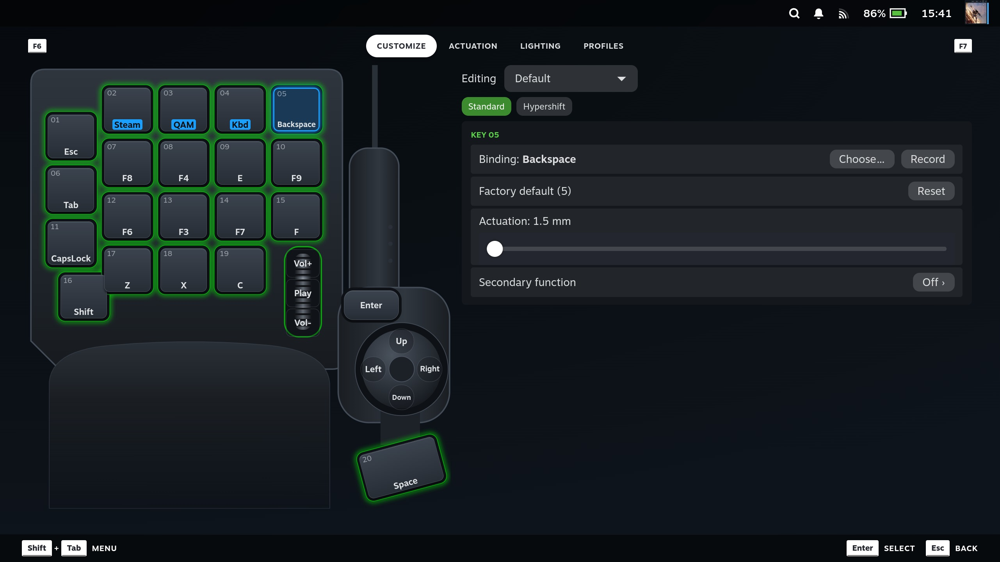
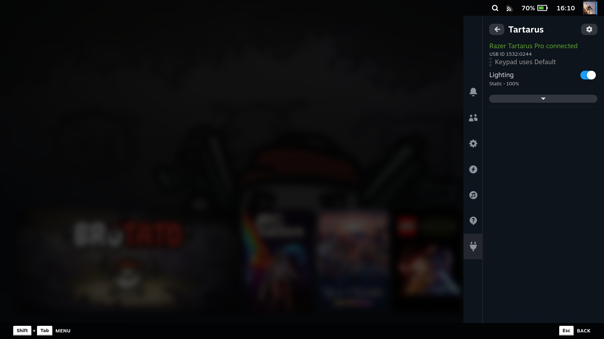
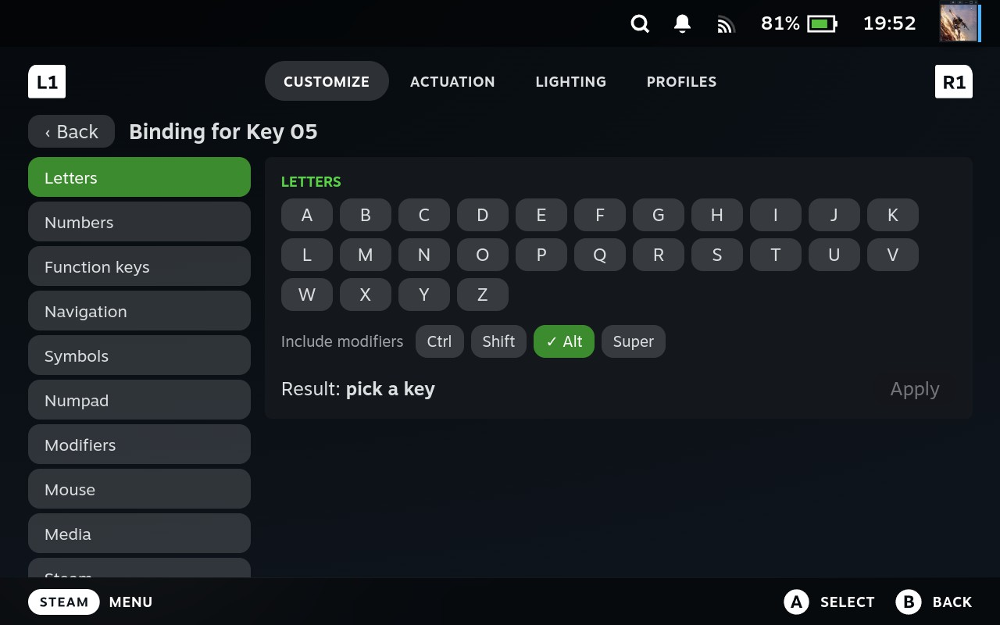
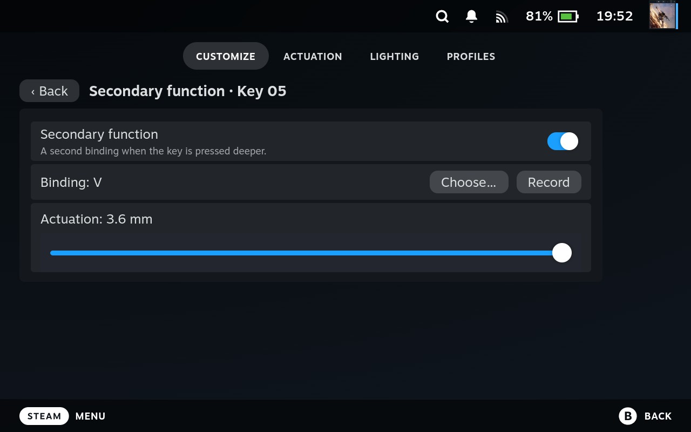
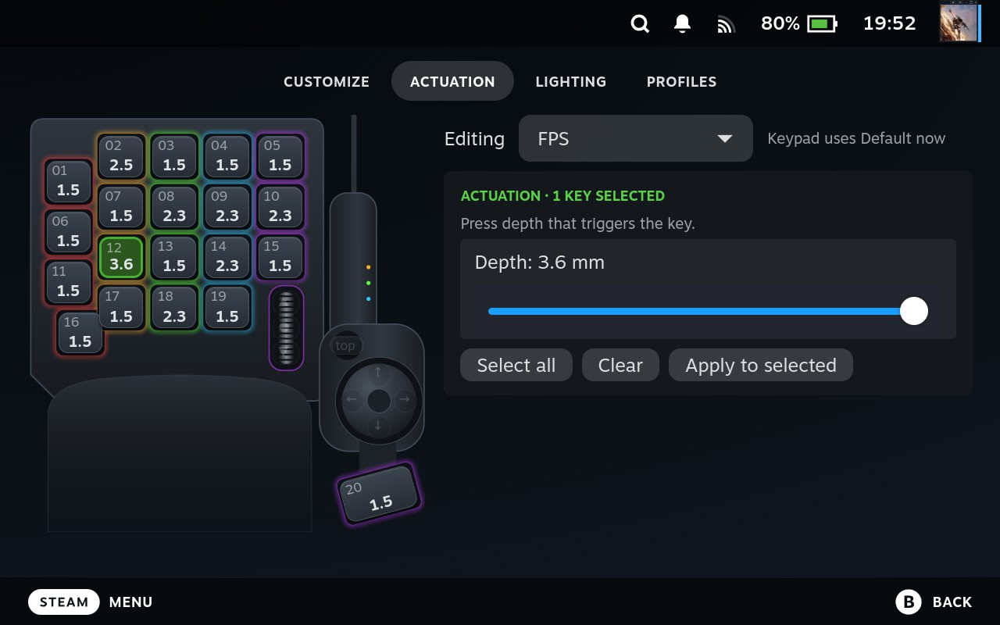
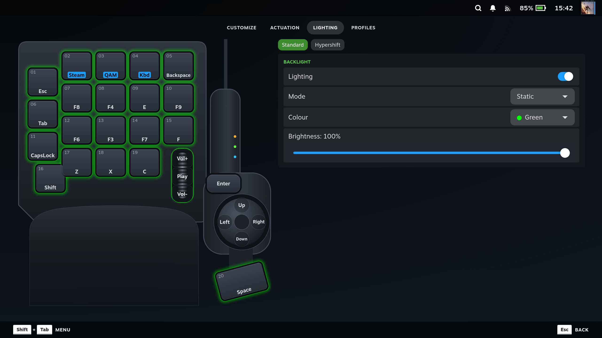
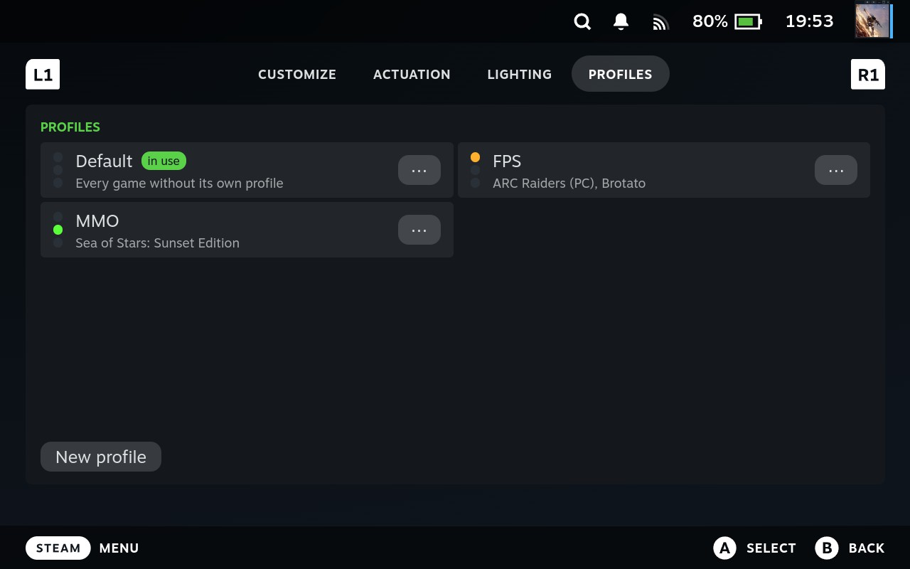
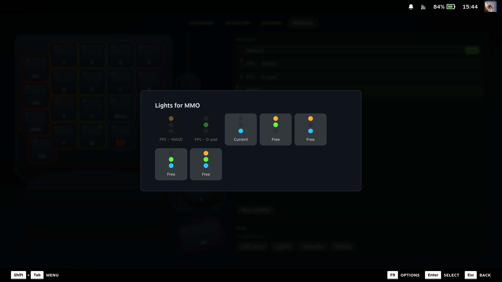

# Decky Tartarus

A [Decky Loader](https://github.com/SteamDeckHomebrew/decky-loader) plugin for the
**Razer Tartarus Pro** (2019, USB `1532:0244`) on a Steam Deck in Game Mode. It does what
Razer Synapse does on Windows, without Synapse or OpenRazer.

## Features

- **Remap every control:** keys 01-20 (20 is the big thumb key), the button above the D-pad,
  scroll up/down, wheel click and the D-pad (4-way or 8-way). Keys, shortcuts, held combos,
  macros, mouse buttons, media keys, or nothing.
- **Adjustable actuation:** set how deep each key has to go before it fires, from 1.5 to
  3.6 mm, for one key, a selection or all of them.
- **Secondary function:** a second binding on the same key at a deeper point, for example
  `C` at a light press and `Z` when pressed all the way.
- **Hypershift:** hold one key (any of 01-20 or the button above the D-pad) and the other
  keys switch to a second set of bindings, each with its own depth and secondary function.
  Keys you leave alone keep their normal binding. Not the same as the secondary function,
  which is a deeper point on one key's press.
- **Profiles per game:** up to 8 named layouts (Default, FPS, MMO, …). Assign a game while
  you play and the keypad switches whenever that game starts, including non-Steam shortcuts
  such as one Moonlight shortcut per streamed PC game.
- **Profile lights:** the three status lights above the D-pad show which profile is active.
- **Lighting:** static, breathing, spectrum, wave, reactive and starlight, with colour and
  brightness, and an on/off switch that stays off through sleep, replugging and restarts.
- **Steam menus from a key:** open the Steam menu or Quick Access, also while Moonlight is
  fullscreen.
- **Works with streaming:** remapped input goes out through a virtual keyboard and mouse
  (`Decky Tartarus Keyboard`, `Decky Tartarus Mouse`), so Moonlight forwards it like any
  keyboard.
- **Made for the Deck:** every page fits the 1280×800 screen without scrolling and works with
  the D-pad and A/B.

## Using it

### Quick Access panel

Quick Access → Tartarus shows whether the keypad is connected, which profile it uses now
and that profile's status lights. While a game runs, **"&lt;game&gt; uses:"** assigns it a
profile. The Lighting switch turns the backlight on or off, and the bar under it opens the
mode, colour and brightness. The gear next to the title opens the editor.

### Editor

The editor has four tabs (L1 / R1 switch between them):

- **Customize:** pick a control on the drawing, then set it on the card beside it:
  - **Choose…** picks from categories (letters, numbers, function keys, navigation,
    symbols, numpad, modifiers, mouse, media, Steam, disable) with optional Ctrl / Shift /
    Alt / Super, or lets you type a binding.
  - **Record** takes the next key or combo pressed on the keypad or any keyboard.
  - **Factory default** puts the key back.
  - The **actuation** slider sets the key's depth.
  - **Secondary function** opens a page for the deeper binding and its depth.
  - **8-way** switches the D-pad between 4 and 8 directions.
  - **Standard / Hypershift** switch: pick **Hypershift** to edit the second layer. Choose a
    key's **Choose… → Hypershift** on Standard to make it the Hypershift key. On the
    Hypershift layer each control shows **Same as Standard** until you give it its own
    binding, depth or secondary function, and **Clear** removes its entry again. The
    Hypershift key itself is shown locked.
- **Actuation:** select keys on the drawing (or **Select all**), set a depth and
  **Apply to selected**. Each key shows its depth in mm. The Standard / Hypershift switch
  works here too; on Hypershift only keys that have a Hypershift binding can be selected.
- **Lighting:** the same controls as the panel, with more room.
- **Profiles:** create, rename and delete profiles, edit one's keys, and pick its
  status-light pattern under **Lights**. Patterns another profile uses are shown with its
  name and can't be picked.

The **Editing** dropdown at the top of Customize and Actuation picks which profile you
edit, and it says which profile the keypad uses now. Changes apply at once.

| | |
|---|---|
|  |  |
| **Choose…**: categories, a key grid and modifiers | **Secondary function**: a second binding deeper in the press |
|  |  |
| **Actuation**: each key shows its depth in mm | **Lighting**: mode, colour and brightness |
|  |  |
| **Profiles**: games per profile and their status lights | **Lights**: patterns other profiles use are taken |

## Install

Needs a Steam Deck (SteamOS, Game Mode) with [Decky Loader](https://decky.xyz/). The
backend runs as root (`/dev/input`, `/dev/uinput`, `/dev/hidraw*`).

- **From the zip:** build it with `scripts/package.sh` (needs `pnpm`), copy
  `out/decky-tartarus.zip` to the Deck, then in Decky → Settings → enable Developer Mode →
  Developer → Install Plugin from ZIP File (or from a URL to the zip).
- **By hand:** copy the plugin folder to `~/homebrew/plugins/decky-tartarus/`
  (needs `sudo`), then reload Decky or reboot.

## Binding text

**Choose… → Type a binding** takes text:

| Text | Does |
|---|---|
| `Esc`, `F5`, `A` | one key, held while the trigger is held |
| `Shift`, `Ctrl`, `Alt` | held modifier |
| `Ctrl+C`, `Alt+F4` | shortcut, sent once on press |
| `hold:W+A` | keys held together while the trigger is held |
| `A, B, Ctrl+C` | macro: the steps in order |
| `LMB`, `RMB`, `MMB`, `Mouse4`, `Mouse5`, `WheelUp`, `WheelDown` | mouse |
| `Vol+`, `Vol-`, `Mute`, `Play`, `Next`, `Prev` | media keys |
| `steam:menu`, `steam:qam` | open or close the Steam menu / Quick Access |
| `disable` | the key does nothing |

Names are not case-sensitive. In 4-way mode a diagonal on the D-pad holds both
neighbouring directions' bindings.

## How it works

While the plugin runs, it puts the keypad in Razer's *driver mode*, the same mode Synapse
uses. In this mode keys 01-20 report how far down they are instead of on/off, and the
plugin decides when a key fires. That's what makes actuation and the secondary function
possible without anything stored on the keypad. A key fires on the report that crosses its
point, with no smoothing delay. When the plugin stops, the keypad goes back to normal mode
and its factory keys.

The depth-to-mm table comes from measuring where Synapse fires on this keypad. The plugin
only sends commands seen from Synapse or OpenRazer for this keypad.

## How it was built

Razer documents none of this, so the protocol was worked out step by step:

1. **Start from what's known.** OpenRazer and earlier projects gave the lighting commands
   and the keypad's normal-mode input, which was enough for remapping and lighting.
2. **Watch Synapse.** On a Windows PC, Wireshark with USBPcap recorded the USB traffic
   while Synapse changed settings, one change per capture
   (`scripts/record-synapse.ps1`). A small parser read the captures. This showed that
   Synapse never stores actuation on the keypad: it puts it in a *driver mode* where the
   keys stream their depth, and decides on the PC when a key fires. It also showed the
   command for the profile lights.
3. **Measure.** Pressing keys slowly next to a key log in Synapse gave the depth where
   each mm setting fires; that table is what the plugin uses.
4. **Try it on the Deck carefully.** Read-only tools (`scripts/read-depth.py`) came first,
   then one fixed command at a time (`scripts/deck-probe.py`), each send approved by hand.
   The plugin only sends commands confirmed this way.
5. **Build and test on the hardware.** Each feature was written up as a design, built in
   small steps with automated tests for the backend, and checked on a Deck with a
   checklist before moving on. The notes are in `docs/superpowers/`.

The code was written with [Claude Code](https://claude.com/claude-code).

## Settings

One JSON file: `~/homebrew/settings/decky-tartarus/settings.json`. It survives reboots and
plugin updates. A file that can't be read is kept as `settings.json.corrupt-<time>` and the
plugin starts with factory keys. Bindings, lighting and the profile lights are reapplied
when the keypad is plugged back in and after sleep.

## Notes

- **Secondary function:** a normal full press sends the first binding briefly before the
  second, because at least one depth report lands between the two points. Synapse does the
  same. A fast, hard press sends only the second.
- **Steam menu keys** use Steam's own navigation, not the Ctrl+1 / Ctrl+2 shortcuts: under
  fullscreen Moonlight those keystrokes go to the PC and nothing opens on the Deck.
- **Record** can't capture wheel ticks; pick them under Mouse or type `WheelUp` /
  `WheelDown`.
- Only lighting effects the keypad runs itself are offered. Ripple needs software-streamed
  frames and is left out.

## Roadmap

- **Per-game lighting:** lighting is the same for every profile today.
- **Actuation calibration:** check the mm scale against the physical key travel. The 3.6 mm
  point feels a little past halfway; Synapse feels the same.
- **Plugin Store:** a release zip and a listing in the Decky Plugin Store.
- Being considered, not planned: rapid trigger, and key depth as an analog stick axis.

## Uninstall

Remove it in Decky. The keypad goes back to normal mode and its factory keys at once: the
grab and the virtual devices are tied to the plugin's process, so even a crash or kill
releases them. The settings file stays in `~/homebrew/settings/decky-tartarus/`; delete it
if you want.

## Credits

- [KEYZER](https://github.com/jagbhandal/keyzer) (MIT): binding types and the first editor
  layout.
- [OpenTartarus](https://github.com/moparmaniac412/OpenTartarus) (MIT): binding semantics.
- [OpenRazer](https://github.com/openrazer/openrazer): reference for the lighting report
  format and effect commands.
- [CSS Loader](https://github.com/DeckThemes/SDH-CssLoader): the look of the panel and
  editor rows.

The keypad picture is our own drawing. MIT licence, see `LICENSE`.
