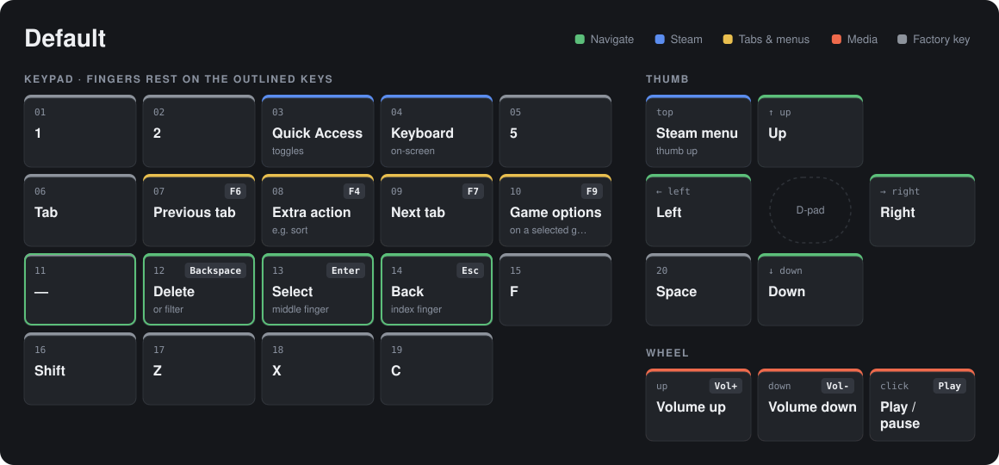
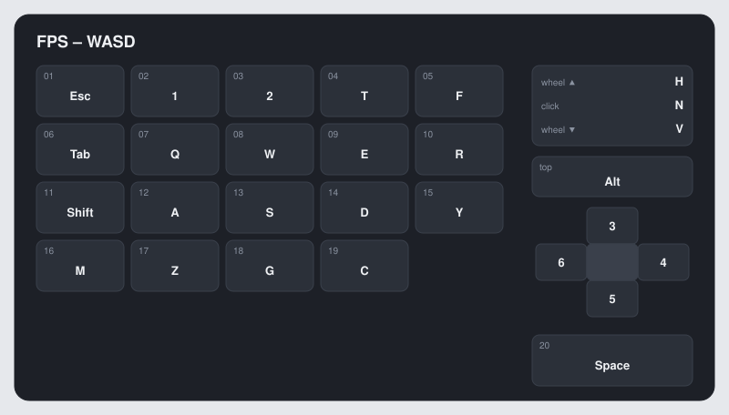
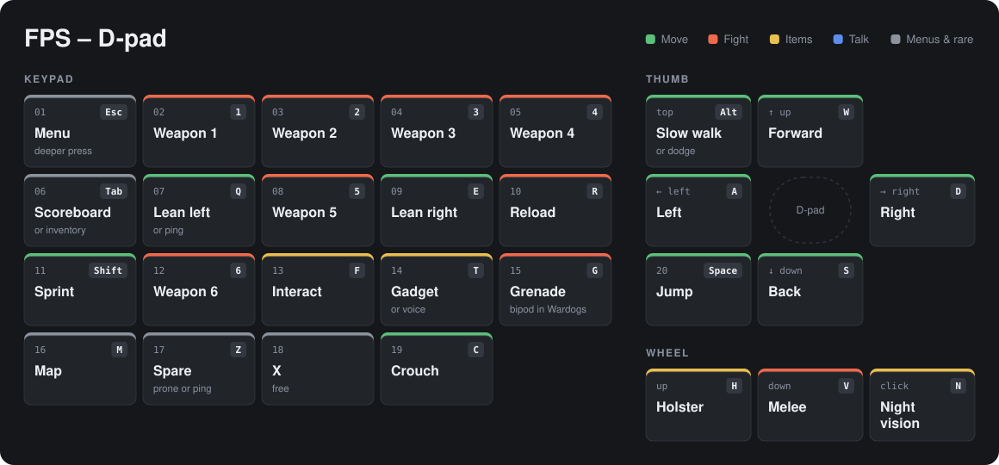
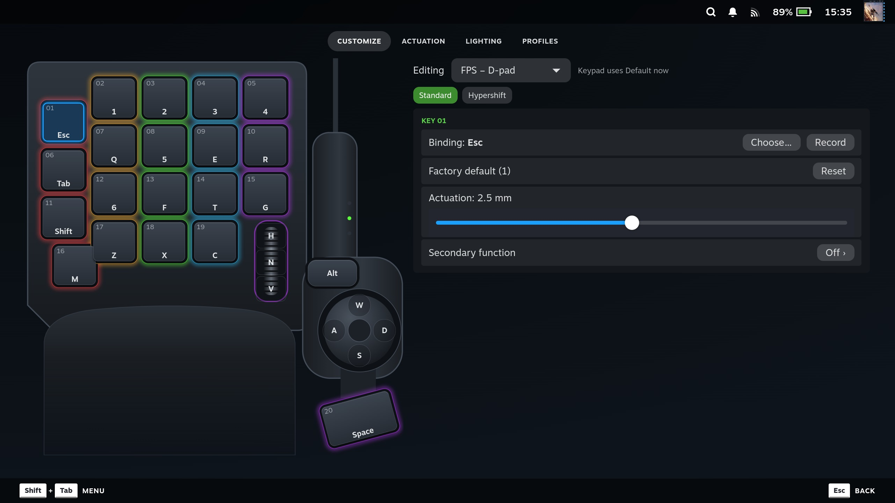
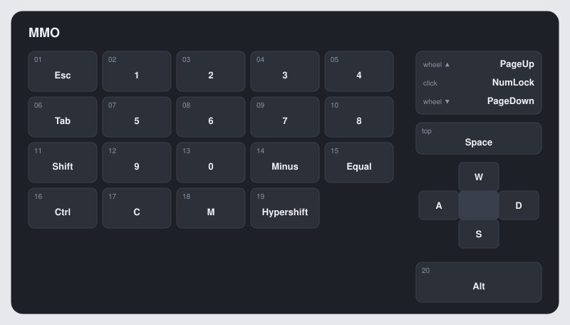
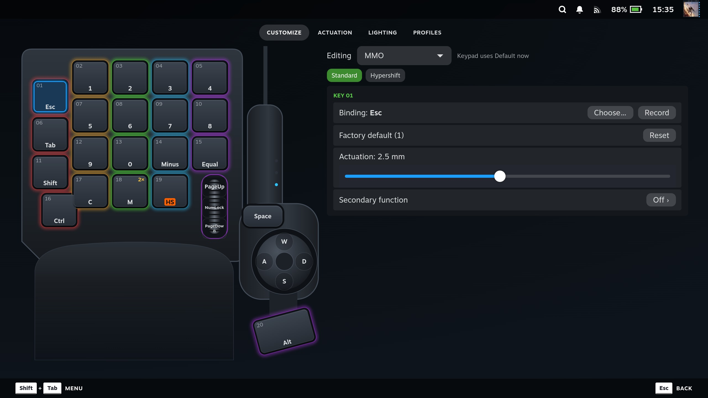
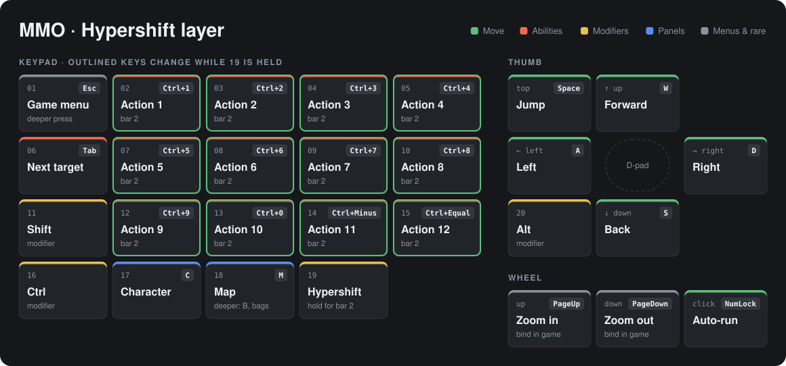
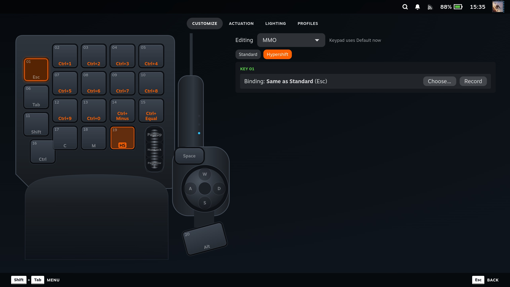
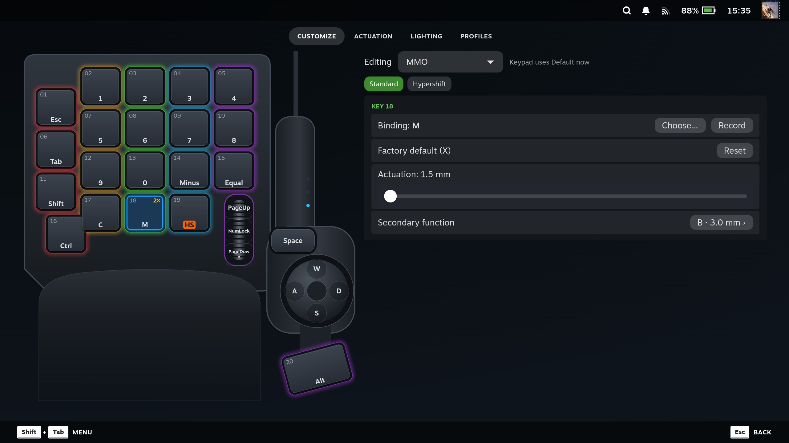

# Starter profiles

A fresh install starts with four profiles: Default (see the README's
[Default layout](../README.md#default-layout)) and three starter profiles, `FPS – WASD`,
`FPS – D-pad` and `MMO`. They are ordinary profiles: edit them, rename them, assign games to them
or delete them. To keep a starter as it is and change a copy, choose **New profile**, open
**Copy from** and pick that profile.

**Made for:**

- **FPS – WASD** and **FPS – D-pad:** Call of Duty, Battlefield and Wardogs.
- **MMO:** World of Warcraft and RuneScape 3 (not Old School).

The starters are starting points, not tested per game: each key holds the default that these games
share, checked against their PC defaults, not in each game's menus. The MMO has
not been tested in a game at all; it is built from World of Warcraft's default key binds.

Where the FPS games differ:

- C is hold-to-crouch in Wardogs and Battlefield; Call of Duty crouches on Left Ctrl.
- Z is not shared (prone and slide in Battlefield, cycle sights in Wardogs, ping or prone in Call
  of Duty), so key 17 is a spare: bind Z in the game to whatever you want there.
- Q is ping in Battlefield.
- G is grenade in Call of Duty and Battlefield, and bipod in Wardogs.

All three starters use the 4-way D-pad, put Esc on key 01 with an actuation of 2.5 mm (deeper
than the default, so the menu does not open by accident), and keep every other key at the default
depth.

Starters are added once, when the plugin first starts and writes its settings. They are never
re-applied, not even by a plugin update: an install that already has settings keeps its own profiles
as you left them, and a starter you delete stays deleted on that install.

## Default

The table is in the README's [Default layout](../README.md#default-layout).

## FPS – WASD

Movement on the keys; the D-pad holds weapon slots 3-6.

| Control | Binding | Usual use |
|---|---|---|
| k01 | Esc (2.5 mm) | menu |
| k02, k03 | 1, 2 | weapon slots 1-2 |
| k04 | T | use gadget / voice |
| k05 | F | interact |
| k06 | Tab | scoreboard / inventory |
| k07, k09 | Q, E | lean (ping in Battlefield) |
| k08, k12, k13, k14 | W, A, S, D | move |
| k10 | R | reload |
| k11 | Shift | sprint |
| k15 | Y | chat |
| k16 | M | map |
| k17 | Z | spare: prone, cycle sights or ping, whatever the game puts on Z |
| k18 | G | grenade (bipod in Wardogs) |
| k19 | C | crouch |
| k20 | Space | jump |
| top_button | Alt | slow walk / dodge |
| dpad up / right / down / left | 3, 4, 5, 6 | weapon slots 3-6 / quick use |
| wheel up / down / click | H, V, N | holster / melee / night vision |

## FPS – D-pad

Movement on the D-pad, so all 20 keys are free. The keys that held W, A, S and D take weapon slots
and interact, so every function of `FPS – WASD` is still on one key, except chat: `FPS – D-pad`
has no chat key (Y). Bind one yourself if your game needs it.

| Control | Binding | Usual use |
|---|---|---|
| k01 | Esc (2.5 mm) | menu |
| k02, k03, k04, k05 | 1, 2, 3, 4 | weapon slots 1-4 |
| k06 | Tab | scoreboard / inventory |
| k07, k09 | Q, E | lean (ping in Battlefield) |
| k08 | 5 | weapon slot 5 |
| k10 | R | reload |
| k11 | Shift | sprint |
| k12 | 6 | weapon slot 6 |
| k13 | F | interact |
| k14 | T | use gadget / voice |
| k15 | G | grenade (bipod in Wardogs) |
| k16 | M | map |
| k17 | Z | spare: prone, cycle sights or ping, whatever the game puts on Z |
| k18 | X | free |
| k19 | C | crouch |
| k20 | Space | jump |
| top_button | Alt | slow walk / dodge |
| dpad up / right / down / left | W, D, S, A | move (a diagonal holds both neighbours) |
| wheel up / down / click | H, V, N | holster / melee / night vision |

## MMO

World of Warcraft's default hotbar (1-0, -, =) on twelve keys, the modifiers within reach, and
movement on the D-pad. RuneScape 3's ability bars use the same number keys and modifiers.

| Control | Binding | Usual use |
|---|---|---|
| k01 | Esc (2.5 mm) | game menu |
| k02, k03, k04, k05 | 1, 2, 3, 4 | action bar 1 |
| k06 | Tab | target next enemy |
| k07, k08, k09, k10 | 5, 6, 7, 8 | action bar 1 |
| k11 | Shift | modifier (Shift+1… for another bar) |
| k12, k13, k14, k15 | 9, 0, -, = | action bar 1 |
| k16 | Ctrl | modifier |
| k17 | C | character panel |
| k18 | M; B at a deeper press (3.0 mm) | map; the deep press opens the bags |
| k19 | Hypershift | hold for action bar 2 |
| k20 | Alt | modifier |
| top_button | Space | jump |
| dpad up / right / down / left | W, D, S, A | move |
| wheel up / down | Page Up, Page Down | camera zoom (bind it in the game) |
| wheel click | Num Lock | auto-run |

**Hypershift layer.** While key 19 is held, keys 02-05, 07-10 and 12-15 send Ctrl plus their
usual key: Ctrl+1 … Ctrl+0, Ctrl+-, Ctrl+=. Bind action bar 2 to those in the game's key bindings.
Every other control keeps its standard binding while key 19 is held.

Notes:

- World of Warcraft has no default for Page Up and Page Down on the camera; bind zoom in and out to
  them in the game, or change the wheel.
- Key 18's deeper press is the one dual-stage key in the starters, there to show the feature on a
  function that does not matter in a fight. Don't make an ability depend on it.

